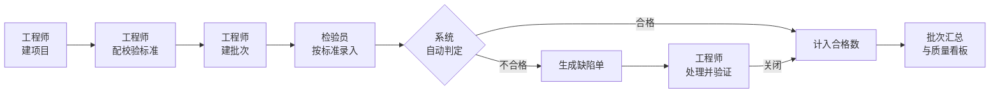
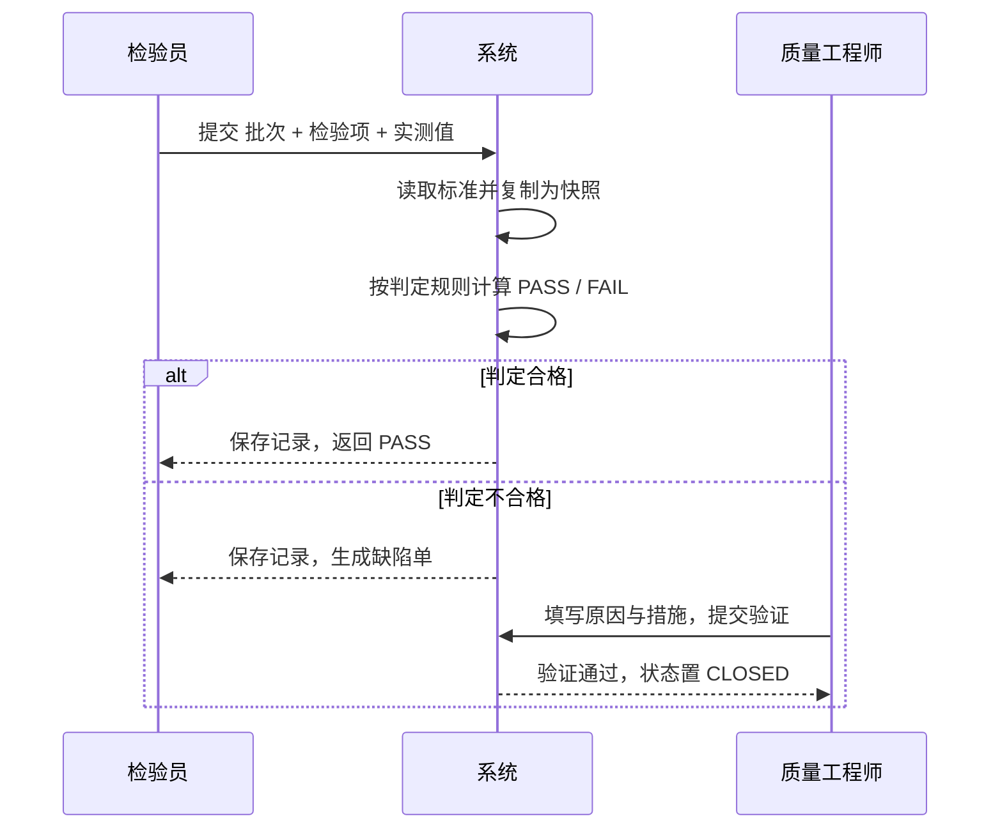
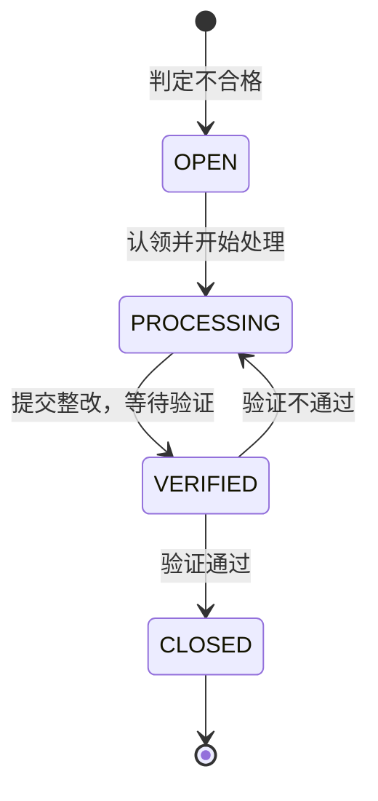
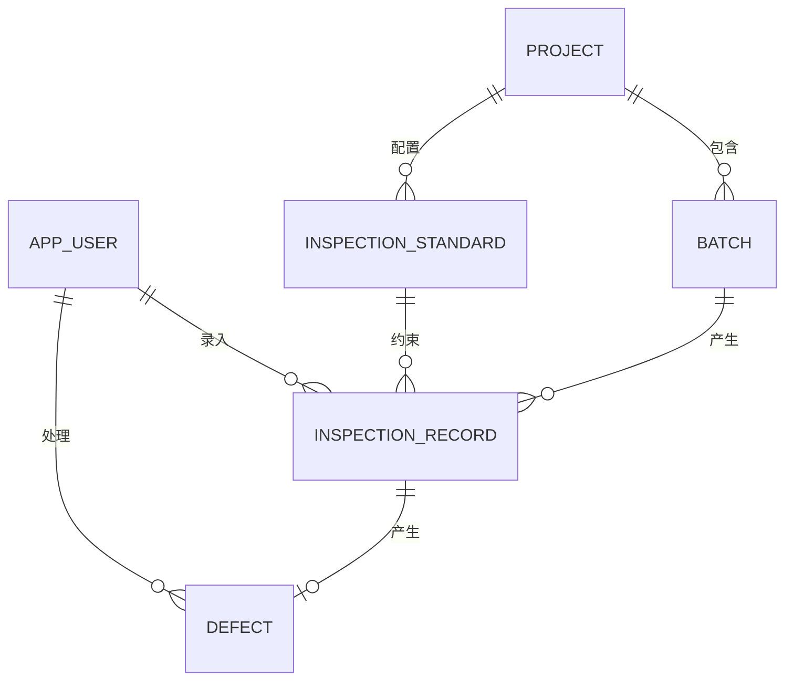

# 光伏组件校验数字化平台
## 软件需求规格说明书

| 项 | 内容 |
|---|---|
| 文档编号 | PVQIMS-SRS-001 |
| 文档版本 | V2.1 |
| 编写日期 | 2026-11-12 |
| 文档状态 | 评审稿 |
| 适用范围 | 软件工程实训 / 课程设计 |
| 产品形态 | B/S 架构 Web 应用 |

### 修订记录

| 版本 | 日期 | 说明 |
|---|---|---|
| V1.0 | 2026-11-12 | 初稿 |
| V1.1 | 2026-11-12 | 统一产品名称与"校验/检验"用词 |
| V2.0 | 2026-11-12 | 重构为独立产品需求文档；补充用例清单、数据字典、需求追踪矩阵与接口清单 |
| V2.1 | 2026-11-16 | 第 5 章调整为 6 张表（缺陷独立为 defect 表，与记录 1:1），新增 v_defect_detail、v_batch_pass_rate 两个视图 |

---

## 1. 引言

### 1.1 编写目的

本文档定义光伏组件校验数字化平台的业务范围、业务流程、功能需求、数据库设计与验收标准，作为概要设计、详细设计、编码与测试的依据。

本文档只描述**本期产品**的需求。凡未在 2.3 节列出的能力，均不属于本期交付范围。

### 1.2 项目背景

光伏组件工厂每天要回答三个问题：

1. 进来的原材料能不能投产？
2. 生产过程中的工艺参数有没有跑偏？
3. 这批成品能不能交付给客户？

现实中的回答方式往往是：检验员拿着纸质单据到工位抄表，回办公室录入 Excel；判定靠人眼比对上下限；发现不合格口头通知，处理进度无人跟踪；月底由工程师手工汇总合格率。

由此产生四个问题：

| 问题 | 后果 |
|---|---|
| 标准散落在文件和个人经验里 | 同一条产线不同班次判定尺度不一 |
| 判定靠人工比对 | 看错、漏判，且无法复核 |
| 不合格没有闭环 | 问题反复出现，责任无法落实 |
| 数据无法聚合 | 管理者看不到趋势，只能看单张报表 |

本产品把上述过程线上化：**标准集中配置、判定由系统执行、不合格自动进入缺陷闭环、数据自动汇总成看板。**

### 1.3 读者对象

| 读者 | 关注章节 |
|---|---|
| 开发人员 | 全部 |
| 指导教师 / 评审方 | 2、3、4、8 |
| 非光伏行业人员 | 1.4、3.1、3.6 |
| 测试人员 | 4.9、5、8、9 |

### 1.4 行业术语（非光伏读者必读）

光伏行业术语密集，不理解这些词就无法理解需求。以下用生活化语言解释，并给出它在系统中的落点。

| 术语 | 通俗解释 | 系统落点 |
|---|---|---|
| 光伏组件 | 把太阳光变成电的"发电板"，由几十片电池片封装而成，一块约 2 平方米、重 30 公斤 | 项目下生产的产品 |
| 电池片 | 组件里真正发电的最小单元，像夹心饼干里的"馅" | 仅作为缺陷描述出现，不单独建表 |
| 功率（Pmax） | 一块组件在标准条件下能发出的最大电功率，单位瓦（W），如 710W | 检验项之一 |
| 功率档位 | 同一条产线做出的组件功率有高有低，工厂按 5W 或 10W 分成不同档次卖给不同客户 | 标准中的目标值与公差 |
| 双面率 | 组件背面也能发电，背面发电量占正面的比例，通常 70%–85% | OQC 检验项 |
| 湿漏电 | 把组件泡在导电液里加电压，检查是否漏电，是潮湿环境下的安全指标 | OQC 检验项 |
| EL（电致发光） | 给组件通电让它自己发光，再用红外相机拍照，能看见肉眼看不见的隐裂、断栅，相当于给组件拍"X 光片" | 人工判定型检验项 |
| 隐裂 | 电池片内部有细小裂纹，外观完好但发电能力下降，是光伏行业最常见的质量缺陷 | 缺陷类型之一 |
| 热斑 | 局部被遮挡或损坏的电池片发热异常，严重时会烧坏组件 | 缺陷类型之一 |
| IQC | Incoming Quality Control，**来料检验**：原材料进厂时检查，类似餐厅验收供应商送来的食材 | 场景 = IQC |
| PQC | Process Quality Control，**过程检验**：生产中定时到工位抽查，类似厨师做菜过程中试味 | 场景 = PQC |
| OQC | Outgoing Quality Control，**出货检验**：成品出厂前抽检，类似外卖封箱前检查 | 场景 = OQC |
| 批次 | 同一订单、同一生产周期内的一批组件，有批号和计划数量 | 批次表 |
| 巡检 | 检验员按规定时间到产线工位记录参数，不是坐在办公室填表 | 校验录入 |
| 抽样 | 不逐块检查，按规则抽几块代表整批，因为破坏性检测成本高 | 标准中的抽样说明 |
| 合格率 / 良率 | 合格数量 ÷ 检验总数，工厂最关心的一个数 | 看板核心指标 |
| 缺陷等级 | 按严重程度分级：致命 / 严重 / 轻微（A/B/C），决定处理优先级 | defect 表字段 |
| 序列号 | 每块组件唯一的编号，用于追溯是哪一块出了问题 | 记录中的 serial_no |

> [!NOTE]
> **用词约定**：系统名称、菜单、页面标题、按钮等界面文案使用"校验"；质量体系中的业务概念与角色（检验、检验员、来料检验、检验记录等）使用"检验"。二者在本系统中指同一件事；引用 IQC/PQC/OQC 时统一写作"检验"。

### 1.5 一句话解释这门生意

组件单价数千元，一个批次动辄上千块。**若整批货到客户手里才发现问题，返工、退货、索赔的损失远大于在生产线上早发现。** 本系统的价值就是把"事后扯皮"变成"过程中留痕、异常早拦截"。

---

## 2. 产品概述

### 2.1 产品定位

面向光伏组件制造企业质量控制部门的一套轻量级检验管理系统：

> 工程师定规则 → 检验员录数据 → 系统判合格 → 不合格进缺陷闭环 → 数据汇成看板。

产品不承担生产排程、物料采购、设备控制等职责，只解决"质量数据从产生到可用"这一段的数字化。

### 2.2 建设目标

| 目标 | 可验证的结果 |
|---|---|
| 标准可配置 | 新增一个检验项不需要改代码 |
| 判定自动化 | 录入数值后系统立即给出 PASS/FAIL，不靠人眼比对 |
| 异常可闭环 | 每条不合格记录都有责任人、状态和处理结果 |
| 质量可量化 | 任意项目、批次、时间段的合格率可查询、可成图 |
| 历史可追溯 | 标准修改后，历史记录仍显示当时的判定依据 |

### 2.3 范围

**本期交付：**

- 项目、批次两级业务主数据
- 三类检验场景（IQC / PQC / OQC）共用一套标准模型
- 校验标准配置（判定方式、上下限、单位）
- 校验记录录入与自动判定
- 缺陷单生成、处理、验证、关闭
- 批次合格率汇总与质量看板（8 张图）
- 三种角色的权限隔离

**不属于本期交付：**

- 通用权限框架（菜单权限、数据权限、部门、岗位、字典管理）
- 定时任务、代码生成、动态表单
- Excel 批量导入、Word 日报 / 批次报告生成
- 制造商层级、BOM、物料主数据、供应商评分
- 可靠性试验预测（PID / LID / UV / DH / TC）、SPC 实时预警
- 日追踪实验（胶含量、剥离测试）、Inline 抽检
- 与 MES、ERP 的接口对接
- 多租户、多语言、移动端 App

### 2.4 用户角色

| 角色 | 一句话职责 | 典型操作 | 禁止操作 |
|---|---|---|---|
| 质量工程师 ENGINEER | 定规则、看结果、管缺陷 | 建项目/批次、配标准、处理缺陷、查看板 | 管理用户 |
| 检验员 INSPECTOR | 按标准执行检验 | 选批次、录数据、看自己的记录 | 改标准、删记录、看用户管理 |
| 管理员 ADMIN | 管账号与系统 | 用户增删改、重置密码、作废记录 | 修改检验数据内容 |

> 制造商、业主是数据维度而非登录角色，不为其建立账号。

### 2.5 技术约束

| 项 | 要求 |
|---|---|
| 架构 | B/S，前后端分离 |
| 部署 | 企业内网，单实例部署 |
| 数据库 | MySQL 8.0 及以上 |
| 浏览器 | Chrome / Edge 最新两个版本 |
| 编码 | 页面与数据统一 UTF-8 |
| 时间 | 服务器统一 Asia/Shanghai，存储 DATETIME |

---

## 3. 核心业务链

### 3.1 三道校验关口

光伏组件从原料到交付要过三道关。本系统的场景字段（scene）就是这三道关：

```figure
物料进场 ──► ┌──────────────┐
             │ IQC 来料检验 │──► 来料合格才投产
             └──────────────┘
生产制造 ──► ┌──────────────┐
             │ PQC 过程检验 │──► 参数异常即停线
             └──────────────┘
成品出货 ──► ┌──────────────┐
             │ OQC 出货检验 │──► 成品合格才放行
             └──────────────┘
```

### 3.2 核心业务闭环



### 3.3 端到端流程

| 步骤 | 角色 | 输入 | 系统行为 | 输出 |
|---|---|---|---|---|
| 1 建项目 | 工程师 | 项目编号、型号、客户、制造商 | 校验编号唯一 | 项目记录 |
| 2 配标准 | 工程师 | 场景、工序、检验项、判定方式、上下限 | 校验区间合法（下限 < 上限） | 校验标准 |
| 3 建批次 | 工程师 | 批号、计划数量、起止日期 | 校验项目内批号唯一 | 批次记录 |
| 4 录检验 | 检验员 | 项目→批次→场景→检验项→实测值 | 取标准、算判定、写快照 | 校验记录 |
| 5 判不合格 | 系统 | 判定结果 | 自动生成缺陷单，状态 OPEN | 缺陷单 |
| 6 处理缺陷 | 工程师 | 原因、措施 | 状态流转 | 处理记录 |
| 7 验证关闭 | 工程师 | 验证结论 | 状态置 CLOSED | 闭环 |
| 8 看汇总 | 全员 | 项目/批次/时间筛选 | 聚合计算 | 看板与图表 |

### 3.4 一次录入发生了什么



### 3.5 缺陷状态机



状态约束：只能沿箭头方向流转，不允许跳级（OPEN 不能直接到 CLOSED），每次流转记录操作人与时间。

### 3.6 这条链为什么这样设计

| 设计 | 业务原因 |
|---|---|
| 标准与记录分离 | 标准是"规矩"，记录是"事实"。规矩可以改，事实不能改。 |
| 判定放在服务端 | 检验员可能看错、改数、绕过页面，判定必须由系统统一执行。 |
| 记录里存标准快照 | 客户三个月后质疑判定结果时，能证明"当时按什么标准判的"。 |
| 不合格记录直接带缺陷状态 | 不合格本身就是缺陷，无需再手工建单，减少漏记。 |
| 批次作为统计单位 | 客户按批次收货、按批次索赔，合格率必须能按批次算。 |
| 检验员不能改标准 | 谁定规矩谁不改数据，谁录数据谁不定规矩，是质量体系的基本原则。 |
| 只作废不删除 | 质量数据的价值在追溯，删除即丢失证据链。 |

---

## 4. 业务需求

### 4.1 需求总览

| 编号 | 需求名称 | 优先级 | 角色 |
|---|---|---|---|
| FR-01 | 登录与登出 | P0 | 全部 |
| FR-02 | 用户管理 | P0 | 管理员 |
| FR-03 | 项目管理 | P0 | 工程师 |
| FR-04 | 批次管理 | P0 | 工程师 |
| FR-05 | 校验标准配置 | P0 | 工程师 |
| FR-06 | 标准启用/停用与排序 | P1 | 工程师 |
| FR-07 | 校验任务选择 | P0 | 检验员 |
| FR-08 | 校验录入与自动判定 | P0 | 检验员 |
| FR-09 | 记录查询与筛选 | P1 | 全部 |
| FR-10 | 记录作废 | P2 | 管理员 |
| FR-11 | 缺陷列表 | P0 | 工程师 |
| FR-12 | 缺陷处理与验证 | P0 | 工程师 |
| FR-13 | 批次合格率汇总 | P0 | 全部 |
| FR-14 | 质量看板（8 图） | P0 | 全部 |
| FR-15 | 数据导出 CSV | P2 | 工程师 |
| FR-16 | 演示数据初始化 | P1 | 管理员 |

> 优先级定义：P0 为验收必过项，P1 为应做项，P2 为加分项。

### 4.2 用例清单

| 编号 | 用例 | 参与者 | 简述 | 对应需求 |
|---|---|---|---|---|
| UC-01 | 登录 | 全部 | 账号密码登录，按角色进入不同首页 | FR-01 |
| UC-02 | 管理用户 | 管理员 | 新增、停用、重置密码、分配角色 | FR-02 |
| UC-03 | 管理项目 | 工程师 | 项目增删改查 | FR-03 |
| UC-04 | 管理批次 | 工程师 | 批次增删改查，维护状态 | FR-04 |
| UC-05 | 配置校验标准 | 工程师 | 新建、编辑标准，设置判定方式 | FR-05 |
| UC-06 | 启停与排序标准 | 工程师 | 控制标准是否出现在录入页 | FR-06 |
| UC-07 | 选择校验任务 | 检验员 | 按项目/批次/场景/工序定位待检项 | FR-07 |
| UC-08 | 录入校验数据 | 检验员 | 录入实测值，系统实时判定 | FR-08 |
| UC-09 | 查询校验记录 | 全部 | 多条件筛选与分页 | FR-09 |
| UC-10 | 作废记录 | 管理员 | 填写作废原因，记录保留 | FR-10 |
| UC-11 | 查看缺陷列表 | 工程师 | 按等级/状态/工序筛选 | FR-11 |
| UC-12 | 处理缺陷 | 工程师 | 认领、整改、验证、关闭 | FR-12 |
| UC-13 | 查看批次汇总 | 全部 | 批次合格率与构成 | FR-13 |
| UC-14 | 查看质量看板 | 全部 | 8 张统计图与指标卡 | FR-14 |
| UC-15 | 导出数据 | 工程师 | 按当前筛选条件导出 CSV | FR-15 |

### 4.3 基础数据管理（FR-03 / FR-04）

**需求描述**

- 项目：编号、名称、组件型号、客户、制造商、地点、状态（进行中/已关闭）、备注。
- 批次：所属项目、批号、计划数量、起止日期、状态（计划/生产中/已完成）、备注。
- 项目编号全系统唯一；批号在项目内唯一。
- 已关闭项目下的批次只读；已有记录的批次不允许删除。

**业务解释**

项目对应"给哪个客户、在哪个基地、做哪个型号的订单"；批次对应"这批货是什么时候做的、计划做多少"。没有这两级，检验记录就没有归属，合格率也无从统计。删除限制是因为质量数据一旦产生就具有追溯价值，不能因为录错一个项目名而连带丢失历史。

### 4.4 校验标准配置（FR-05 / FR-06）

**需求描述**

每条标准包含：所属项目、场景（IQC/PQC/OQC）、工序名称、检验项编码、检验项名称、单位、值类型（数值/文字）、判定方式、上下限/目标值/公差、抽样说明、是否启用、排序号。

系统支持的判定方式：

| 判定方式 | 含义 | 判定为 PASS 的条件 | 业务示例 |
|---|---|---|---|
| GT 大于 | 只设下限 | 实测值 > 下限 | 绝缘电阻 > 100 MΩ |
| LT 小于 | 只设上限 | 实测值 < 上限 | 功率衰减 < 3% |
| RANGE 区间 | 上下限 | 下限 ≤ 实测值 ≤ 上限 | 边框厚度 3.0–3.5 mm |
| STD_TOL 标准值±公差 | 目标值与公差 | \|实测值 − 目标值\| ≤ 公差 | 功率 710 ± 5 W |
| PASS_FAIL 人工判定 | 文字结论 | 录入 PASS | 外观无气泡、EL 无隐裂 |

**业务解释**

这张表是整个系统"可配置"的核心：一条标准 = 一个可判定的检验项。新增检验项只是加一行数据，不用改代码；三类场景共用同一张表，所以来料、过程、出货能共用一套录入页面。

**约束**

- 判定方式为 GT/LT/RANGE/STD_TOL 时，上下限或目标值必填，且必须满足下限 < 上限、公差 > 0。
- 停用标准不出现在录入页，但历史记录不受影响。
- 标准变更不回溯修改历史记录。

### 4.5 校验执行（FR-07 / FR-08）

**需求描述**

检验员按 项目 → 批次 → 场景 → 工序 的路径筛选出待检项，逐项录入：

- 数值型：录入数字，系统按标准实时判定；
- 文字型：从 PASS / FAIL 中选择，或录入缺陷描述；
- 可填写组件序列号，用于后续追溯到具体组件；
- 提交时由服务端重新判定，不信任前端结果；
- 保存的同时复制标准快照（下限、上限、目标值、公差、单位）。

**业务解释**

巡检的本质是"在产线上定时抄表"，所以录入必须快：默认带出最近使用的批次和工序，回车即可跳到下一项。判定必须自动，是因为人眼比对上下限容易出错，而且不同检验员标准不一。序列号可选，是为了在"只知道是哪块组件坏了"时能反查它的检验记录。

### 4.6 缺陷闭环（FR-11 / FR-12）

**需求描述**

判定为 FAIL 的记录自动成为缺陷单，包含：缺陷类型、缺陷等级（致命/严重/轻微）、状态、处理人、处理说明、解决时间。缺陷单在数据库中对应 `defect` 表，与记录 1:1。

- 缺陷类型从固定枚举选择（隐裂、虚焊、气泡、脱层、功率不足、外观不良、其他）；
- 状态：OPEN → PROCESSING → VERIFIED → CLOSED，验证不通过退回 PROCESSING；
- 缺陷列表支持按等级、状态、工序、时间段筛选；
- 关闭时必须填写处理说明。

**业务解释**

不合格不是终点，而是起点。只记录不合格而不跟踪处理，等于把问题留在产线上。状态机的作用是让每个问题都有明确的下一个责任人和截止条件，看板上的"未关闭缺陷数"就是质量工程师每天要盯的数。

### 4.7 汇总与看板（FR-13 / FR-14）

**需求描述**

- 批次合格率 = 合格记录数 ÷ 有效记录总数（作废记录不计入）。
- 支持按项目、批次、场景、工序、时间段筛选。
- 看板展示 8 张图（详见 6.3），数据实时查询，不做预聚合。

**业务解释**

管理者不关心每一条记录，只关心"这批货行不行、问题集中在哪、谁在处理"。看板就是把明细数据翻译成管理语言。

### 4.8 权限（FR-01 / FR-02）

| 功能 | 工程师 | 检验员 | 管理员 |
|---|---|---|---|
| 项目管理 | 增删改查 | 只读 | 只读 |
| 批次管理 | 增删改查 | 只读 | 只读 |
| 标准配置 | 增删改查 | 无权限 | 只读 |
| 校验录入 | 可录入 | 可录入 | 不可录入 |
| 记录作废 | 无权限 | 无权限 | 可操作 |
| 缺陷处理 | 可操作 | 只读 | 只读 |
| 用户管理 | 无权限 | 无权限 | 增删改查 |
| 看板 | 可查看 | 可查看 | 可查看 |

**业务解释**

权限设计遵循"职责分离"：定标准的人不录数据，录数据的人不改标准，改账号的人不碰业务数据。这是质量体系审核的基本要求。

### 4.9 业务规则汇总

| 编号 | 规则 | 违反时的处理 |
|---|---|---|
| BR-01 | 判定必须在服务端执行 | 前端结果仅作展示，提交后以服务端为准 |
| BR-02 | 记录必须保存标准快照 | 缺失快照的记录视为无效数据 |
| BR-03 | 记录的项目必须与批次所属项目一致 | 拒绝保存 |
| BR-04 | FAIL 记录必须有缺陷类型与等级 | 拒绝保存并提示，且同事务写入 defect 表 |
| BR-05 | 缺陷状态只能顺序流转 | 非法流转返回错误 |
| BR-06 | 停用标准不可新增记录 | 录入页不展示该标准 |
| BR-07 | 检验员不得修改标准与删除记录 | 接口层拒绝 |
| BR-08 | 记录只作废不物理删除 | 统计时排除作废记录 |
| BR-09 | 已有记录的批次不得删除 | 拒绝删除 |
| BR-10 | 项目关闭后其批次只读 | 写操作返回错误 |

---

## 5. 数据库设计

### 5.1 设计原则

1. **六张业务表覆盖全流程**：app_user、project、batch、inspection_standard、inspection_record、defect，不引入权限框架表（无菜单表、字典表、部门表）。
2. **标准与记录分离**，记录保存标准快照，保证历史可追溯。
3. **记录与缺陷分离**：inspection_record 只承载判定结果；判定为 FAIL 时在同一事务内生成 1:1 的 defect 记录，避免非缺陷记录出现大量 NULL 列。
4. **统计口径统一**：合格率从 inspection_record 聚合，缺陷统计从 defect 聚合，明细联查走视图。
5. 字符集 utf8mb4，引擎 InnoDB，主键 BIGINT 自增。

### 5.2 ER 图



### 5.3 app_user 用户表

| 字段 | 类型 | 约束 | 说明 |
|---|---|---|---|
| id | BIGINT | PK, AUTO_INCREMENT | 主键 |
| username | VARCHAR(50) | NOT NULL, UNIQUE | 登录名 |
| password_hash | VARCHAR(100) | NOT NULL | BCrypt 哈希，禁止明文 |
| display_name | VARCHAR(50) | NOT NULL | 显示姓名 |
| role | VARCHAR(20) | NOT NULL | INSPECTOR / ENGINEER / ADMIN |
| is_active | TINYINT | NOT NULL DEFAULT 1 | 1 启用，0 停用 |
| created_at | DATETIME | NOT NULL | 创建时间 |

### 5.4 project 项目表

| 字段 | 类型 | 约束 | 说明 |
|---|---|---|---|
| id | BIGINT | PK | 主键 |
| project_code | VARCHAR(50) | NOT NULL, UNIQUE | 项目编号 |
| project_name | VARCHAR(100) | NOT NULL | 项目名称 |
| product_model | VARCHAR(50) | NULL | 组件型号，如 710W 双玻 |
| customer_name | VARCHAR(100) | NULL | 业主/客户 |
| manufacturer_name | VARCHAR(100) | NULL | 制造商 |
| location | VARCHAR(100) | NULL | 项目地点 |
| status | VARCHAR(20) | NOT NULL DEFAULT 'ACTIVE' | ACTIVE / CLOSED |
| remark | VARCHAR(255) | NULL | 备注 |
| created_at | DATETIME | NOT NULL | 创建时间 |

### 5.5 batch 批次表

| 字段 | 类型 | 约束 | 说明 |
|---|---|---|---|
| id | BIGINT | PK | 主键 |
| project_id | BIGINT | NOT NULL, FK → project.id | 所属项目 |
| batch_no | VARCHAR(50) | NOT NULL | 批号 |
| planned_qty | INT | NOT NULL | 计划数量（块） |
| start_date | DATE | NULL | 批次开始日期 |
| end_date | DATE | NULL | 批次结束日期 |
| status | VARCHAR(20) | NOT NULL DEFAULT 'PLANNED' | PLANNED / PRODUCING / COMPLETED |
| remark | VARCHAR(255) | NULL | 备注 |
| created_at | DATETIME | NOT NULL | 创建时间 |

唯一约束：`UNIQUE (project_id, batch_no)`。

### 5.6 inspection_standard 校验标准表

| 字段 | 类型 | 约束 | 说明 |
|---|---|---|---|
| id | BIGINT | PK | 主键 |
| project_id | BIGINT | NOT NULL, FK → project.id | 所属项目 |
| scene | VARCHAR(10) | NOT NULL | IQC / PQC / OQC |
| process_name | VARCHAR(50) | NOT NULL | 工序或检验环节名称 |
| item_code | VARCHAR(30) | NOT NULL | 检验项编码 |
| item_name | VARCHAR(100) | NOT NULL | 检验项名称，如 Pmax、湿漏电 |
| unit | VARCHAR(20) | NULL | 单位，如 W、MΩ、mm |
| value_type | VARCHAR(10) | NOT NULL | NUMERIC / TEXT |
| judge_type | VARCHAR(20) | NOT NULL | GT / LT / RANGE / STD_TOL / PASS_FAIL |
| lower_limit | DECIMAL(12,4) | NULL | 下限（GT/RANGE 使用） |
| upper_limit | DECIMAL(12,4) | NULL | 上限（LT/RANGE 使用） |
| target_value | DECIMAL(12,4) | NULL | 标准值（STD_TOL 使用） |
| tolerance | DECIMAL(12,4) | NULL | 公差（STD_TOL 使用） |
| sampling_note | VARCHAR(100) | NULL | 抽样/频次说明，如"每 2 小时抽 5 块" |
| is_enabled | TINYINT | NOT NULL DEFAULT 1 | 是否启用 |
| sort_order | INT | NOT NULL DEFAULT 0 | 录入页排序 |
| remark | VARCHAR(255) | NULL | 备注 |
| created_at | DATETIME | NOT NULL | 创建时间 |

唯一约束：`UNIQUE (project_id, item_code)`。

### 5.7 inspection_record 校验记录表

| 字段 | 类型 | 约束 | 说明 |
|---|---|---|---|
| id | BIGINT | PK | 主键 |
| project_id | BIGINT | NOT NULL, FK → project.id | 冗余项目，便于统计 |
| batch_id | BIGINT | NOT NULL, FK → batch.id | 所属批次 |
| standard_id | BIGINT | NOT NULL, FK → inspection_standard.id | 依据标准 |
| scene | VARCHAR(10) | NOT NULL | 场景快照 |
| process_name | VARCHAR(50) | NOT NULL | 工序快照 |
| item_name | VARCHAR(100) | NOT NULL | 检验项快照 |
| serial_no | VARCHAR(50) | NULL | 组件序列号 |
| inspector_id | BIGINT | NOT NULL, FK → app_user.id | 检验员 |
| inspect_time | DATETIME | NOT NULL | 检验时间 |
| measured_value | DECIMAL(12,4) | NULL | 实测值（数值型必填） |
| text_value | VARCHAR(100) | NULL | 文字结论（PASS_FAIL 使用） |
| result | VARCHAR(10) | NOT NULL | PASS / FAIL |
| std_lower | DECIMAL(12,4) | NULL | 标准下限快照 |
| std_upper | DECIMAL(12,4) | NULL | 标准上限快照 |
| std_target | DECIMAL(12,4) | NULL | 标准值快照 |
| std_tolerance | DECIMAL(12,4) | NULL | 公差快照 |
| std_unit | VARCHAR(20) | NULL | 单位快照 |
| is_void | TINYINT | NOT NULL DEFAULT 0 | 作废标记，统计时排除 |
| void_reason | VARCHAR(255) | NULL | 作废原因（作废时必填） |
| remark | VARCHAR(255) | NULL | 备注 |
| created_at | DATETIME | NOT NULL | 创建时间 |

> 判定为 FAIL 的记录在同一事务内生成一条 defect 记录，二者 1:1；缺陷列表与看板通过视图 `v_defect_detail` 联查。

### 5.8 defect 缺陷表

| 字段 | 类型 | 约束 | 说明 |
|---|---|---|---|
| id | BIGINT | PK | 主键 |
| record_id | BIGINT | NOT NULL, UNIQUE, FK → inspection_record.id | 来源记录，1:1 |
| defect_type | VARCHAR(50) | NOT NULL | 缺陷类型 |
| defect_grade | VARCHAR(10) | NOT NULL | CRITICAL / MAJOR / MINOR |
| defect_status | VARCHAR(20) | NOT NULL DEFAULT 'OPEN' | OPEN / PROCESSING / VERIFIED / CLOSED |
| handler_id | BIGINT | NULL, FK → app_user.id | 处理人 |
| handle_note | VARCHAR(255) | NULL | 处理说明 |
| resolved_at | DATETIME | NULL | 关闭时间 |
| created_at | DATETIME | NOT NULL | 生成时间 |

> 每次状态流转的操作人与时间写入应用日志，不单独建流转表。

### 5.9 索引设计

| 表 | 索引 | 用途 |
|---|---|---|
| inspection_record | `idx_rec_project_time (project_id, inspect_time)` | 看板按项目+时间聚合 |
| inspection_record | `idx_rec_batch (batch_id)` | 批次合格率 |
| inspection_record | `idx_rec_standard_time (standard_id, inspect_time)` | 控制图取序列 |
| inspection_record | `idx_rec_result (result)` | 合格率 |
| defect | `uk_defect_record (record_id)` | 记录与缺陷 1:1 |
| defect | `idx_defect_status_grade (defect_status, defect_grade)` | 缺陷列表与看板 |
| inspection_standard | `uk_std_project_item (project_id, item_code)` | 防重复 |
| batch | `uk_batch_project_no (project_id, batch_no)` | 防重复 |

### 5.10 关键查询

批次合格率：

```sql
SELECT COUNT(*)                                        AS total,
       SUM(result = 'PASS')                            AS passed,
       ROUND(SUM(result = 'PASS') / COUNT(*) * 100, 2) AS pass_rate
FROM inspection_record
WHERE batch_id = ?
  AND is_void = 0;
```

缺陷帕累托（按类型降序）：

```sql
SELECT d.defect_type, COUNT(*) AS cnt
FROM defect d
JOIN inspection_record r ON r.id = d.record_id
WHERE r.project_id = ?
  AND r.is_void = 0
GROUP BY d.defect_type
ORDER BY cnt DESC;
```

控制图取数（某检验项最近 30 次）：

```sql
SELECT inspect_time, measured_value
FROM inspection_record
WHERE standard_id = ?
  AND measured_value IS NOT NULL
  AND is_void = 0
ORDER BY inspect_time DESC
LIMIT 30;
```

缺陷平均处理时长：

```sql
SELECT defect_grade,
       ROUND(AVG(TIMESTAMPDIFF(HOUR, created_at, resolved_at)), 1) AS avg_hours
FROM defect
WHERE defect_status = 'CLOSED'
  AND resolved_at IS NOT NULL
GROUP BY defect_grade;
```

### 5.11 视图设计

| 视图 | 组成 | 用途 |
|---|---|---|
| `v_defect_detail` | defect 联查 inspection_record、batch、project、app_user、inspection_standard | 缺陷列表、缺陷看板，输出批号、项目、工序、检验项、检验员、处理人与标准快照 |
| `v_batch_pass_rate` | inspection_record 按 batch_id 聚合，排除 `is_void = 1` | 批次合格率、批次仪表盘、批次汇总页 |

```sql
CREATE VIEW v_batch_pass_rate AS
SELECT r.batch_id,
       COUNT(*)                                        AS total,
       SUM(r.result = 'PASS')                          AS passed,
       ROUND(SUM(r.result = 'PASS') / COUNT(*) * 100, 2) AS pass_rate
FROM inspection_record r
WHERE r.is_void = 0
GROUP BY r.batch_id;
```

### 5.12 枚举字典

| 枚举 | 取值 | 说明 |
|---|---|---|
| user.role | INSPECTOR / ENGINEER / ADMIN | 检验员 / 质量工程师 / 管理员 |
| project.status | ACTIVE / CLOSED | 进行中 / 已关闭 |
| batch.status | PLANNED / PRODUCING / COMPLETED | 计划 / 生产中 / 已完成 |
| scene | IQC / PQC / OQC | 来料 / 过程 / 出货 |
| value_type | NUMERIC / TEXT | 数值型 / 文字型 |
| judge_type | GT / LT / RANGE / STD_TOL / PASS_FAIL | 五种判定方式 |
| result | PASS / FAIL | 合格 / 不合格 |
| defect_grade | CRITICAL / MAJOR / MINOR | 致命 / 严重 / 轻微 |
| defect_status | OPEN / PROCESSING / VERIFIED / CLOSED | 待处理 / 处理中 / 待验证 / 已关闭 |
| defect_type | CRACK / SOLDER / BUBBLE / DELAMINATION / LOW_POWER / APPEARANCE / OTHER | 隐裂 / 虚焊 / 气泡 / 脱层 / 功率不足 / 外观不良 / 其他 |

### 5.13 设计取舍说明

| 取舍 | 原因 | 代价 |
|---|---|---|
| 三类场景共用一张标准表 | 结构同构，新增场景无须建表 | 场景特有字段无处存放，需扩展字段 |
| 缺陷独立成 defect 表 | 记录表不再出现大量 NULL 列，缺陷统计口径单一 | 多一张表、多一次关联，写入需同事务 |
| 不建物料/BOM 表 | 本期不做到组件级用料追溯 | 无法回答"这块组件用了哪家胶膜" |
| 不建检验项明细表 | 记录已保存标准快照 | 标准被删后无法回溯原始定义（本期标准只停用不删除） |
| 不做预聚合表 | 数据量小，实时查询足够 | 数据量超过百万需改造 |

---

## 6. 界面与图表需求

### 6.1 页面清单

| 编号 | 页面 | 主要功能 | 使用角色 |
|---|---|---|---|
| P1 | 登录 | 账号密码登录 | 全部 |
| P2 | 项目与批次 | 两级主数据的增删改查，批次进度 | 工程师 |
| P3 | 校验标准配置 | 标准列表、编辑、启停、排序 | 工程师 |
| P4 | 校验录入 | 选择批次/工序，逐项录入，实时判定 | 检验员 |
| P5 | 缺陷处理 | 缺陷列表、筛选、处理与验证 | 工程师 |
| P6 | 质量看板 | 8 张图与关键指标卡 | 全部 |
| P7 | 用户管理 | 账号增删改、角色分配、重置密码 | 管理员 |

### 6.2 关键页面交互要求（P4 校验录入）

| 区域 | 要求 |
|---|---|
| 筛选区 | 项目、批次、场景、工序四级联动，默认带出当前用户最近一次使用的组合 |
| 列表区 | 按 sort_order 升序展示启用标准，每行显示检验项、单位、标准值、上次实测值 |
| 录入区 | 数值型为数字输入框，失焦即触发判定；文字型为 PASS / FAIL 按钮组 |
| 缺陷区 | 判定为 FAIL 时就地展开缺陷类型与等级，必填后才能保存 |
| 操作区 | "保存并继续录入"与"保存"；Enter 跳到下一项，Ctrl+Enter 保存 |
| 反馈 | 判定结果用颜色和文字同时表达，不只依赖颜色 |

### 6.3 应用内图表

| 编号 | 图表 | 类型 | 取数口径 | 回答的问题 |
|---|---|---|---|---|
| CH-01 | 每日合格率趋势 | 折线图 | 按 inspect_time 按日聚合 | 质量在变好还是变差 |
| CH-02 | 缺陷帕累托 | 柱状 + 累计折线 | 按 defect_type 计数降序 | 先治哪几类缺陷 |
| CH-03 | 工序合格率对比 | 横向条形图 | 按 process_name 聚合 | 哪道工序是瓶颈 |
| CH-04 | 参数控制图 | 折线 + UCL/CL/LCL | 某标准最近 30 次实测值 | 过程是否失控 |
| CH-05 | 缺陷等级构成 | 堆叠柱状图 | 按 defect_grade × scene | 严重缺陷占比 |
| CH-06 | 批次合格率 | 仪表盘 | 单批次聚合 | 本批能否交付 |
| CH-07 | 检验员工作量 | 柱状图 | 按 inspector_id 计数 | 任务分配是否均衡 |
| CH-08 | 缺陷处理时长 | 分组柱状图 | 按等级统计平均时长 | 闭环效率如何 |

图表实现要求：

- 使用 ECharts，配色统一，支持按项目/批次/时间筛选联动；
- 帕累托图的累计线终点必须为 100%；
- 控制图的控制限取自标准的上下限，不另行计算；
- 无数据时显示空状态提示，不显示空白坐标轴。

### 6.4 工程文档图表

| 图 | 类型 | 交付位置 |
|---|---|---|
| 用例图 | UML Use Case | 详细设计 |
| 核心业务流程图 | 流程图 | 本文 3.2 |
| 校验判定时序图 | UML Sequence | 本文 3.4 |
| 缺陷状态机 | UML State Machine | 本文 3.5 |
| 实体关系图 | ER | 本文 5.2 |
| 系统架构图 | 分层架构 | 详细设计 |
| 部署图 | UML Deployment | 详细设计 |
| 项目计划甘特图 | 甘特 | 项目管理文档 |
| 测试缺陷趋势 | 折线 | 测试报告 |

---

## 7. 非功能需求

| 类别 | 指标 | 验证方式 |
|---|---|---|
| 性能 | 单次录入保存 ≤ 1 秒；看板首屏 ≤ 3 秒（1 万条记录） | 压测脚本计时 |
| 并发 | 10 人同时使用无明显卡顿 | 并发测试 |
| 安全 | 密码 BCrypt 存储；接口按角色鉴权；防止水平越权（检验员只能看本项目数据） | 接口测试 |
| 可用性 | 完成一次录入 ≤ 3 次点击；判定结果即时可见 | 走查 |
| 数据完整性 | 外键约束 + 业务规则校验；作废而非删除 | 用例测试 |
| 兼容性 | Chrome / Edge 最新两个版本 | 浏览器测试 |
| 可维护性 | 判定规则集中在一个服务类；新增判定方式只改一处 | 代码走查 |
| 日志 | 登录、标准变更、缺陷状态流转留痕 | 抽查日志 |
| 备份 | 数据库每日全量备份，保留 7 天 | 检查备份任务 |

---

## 8. 验收标准

| 编号 | 验收项 | 通过条件 |
|---|---|---|
| AC-01 | 标准可配置 | 新增一条 RANGE 标准后，录入页立即出现该检验项 |
| AC-02 | 自动判定 | 录入越界值，系统返回 FAIL 并生成缺陷单 |
| AC-03 | 判定方式覆盖 | 五种 judge_type 各有一条用例通过 |
| AC-04 | 快照不可变 | 修改标准上下限后，历史记录仍显示旧值且判定结果不变 |
| AC-05 | 缺陷闭环 | 状态只能按 OPEN→PROCESSING→VERIFIED→CLOSED 流转，跳级被拒绝 |
| AC-06 | 合格率正确 | 页面数值与手工计算一致（排除作废记录） |
| AC-07 | 权限隔离 | 检验员访问标准编辑接口返回 403 |
| AC-08 | 数据约束 | 项目与批次不匹配的记录无法保存 |
| AC-09 | 图表正确 | 帕累托累计终点 100%；控制图控制限等于标准上下限 |
| AC-10 | 演示数据 | 初始化后有 300 条以上记录，8 张图均有数据 |

---

## 9. 需求追踪矩阵

| 需求 | 用例 | 页面 | 主要表 | 验收 |
|---|---|---|---|---|
| FR-01 登录 | UC-01 | P1 | app_user | AC-07 |
| FR-02 用户管理 | UC-02 | P7 | app_user | AC-07 |
| FR-03 项目管理 | UC-03 | P2 | project | AC-08 |
| FR-04 批次管理 | UC-04 | P2 | batch | AC-08 |
| FR-05 标准配置 | UC-05 | P3 | inspection_standard | AC-01、AC-03 |
| FR-06 启停排序 | UC-06 | P3 | inspection_standard | AC-01 |
| FR-07 任务选择 | UC-07 | P4 | batch、inspection_standard | AC-01 |
| FR-08 录入判定 | UC-08 | P4 | inspection_record | AC-02、AC-04 |
| FR-09 记录查询 | UC-09 | P4、P5 | inspection_record | AC-06 |
| FR-10 记录作废 | UC-10 | P5 | inspection_record | AC-06 |
| FR-11 缺陷列表 | UC-11 | P5 | defect | AC-05 |
| FR-12 缺陷处理 | UC-12 | P5 | defect | AC-05 |
| FR-13 批次汇总 | UC-13 | P6 | inspection_record | AC-06 |
| FR-14 质量看板 | UC-14 | P6 | inspection_record | AC-09 |
| FR-15 数据导出 | UC-15 | P5 | inspection_record | AC-06 |
| FR-16 演示数据 | — | — | 全部 | AC-10 |

---

## 10. 风险与边界

| 风险 | 影响 | 应对 |
|---|---|---|
| 5 张表偏少，不满足课程表数量要求 | 评分受影响 | 已在 V2.1 拆出第 6 张 defect 表，记录表只留判定结果，模型保持一致（本风险已关闭） |
| 演示数据不足 | 图表为空，演示失败 | 提供初始化脚本，生成 30 天 300–500 条数据 |
| 范围蔓延到 Excel 导入/Word 报告 | 工期失控 | 明确列为范围外；如必须做，仅做 CSV 导出 |
| 把"检验场景"理解成三套独立流程 | 重复开发三套页面 | 强制使用 scene 字段区分，页面只做一套 |
| 判定阈值与行业标准不一致 | 演示数据被判错 | 标准全部参数化配置，用样例数据校对；文档不硬编码任何行业阈值 |
| 权限实现过简 | 越权访问 | 至少做到接口级角色校验，不能只隐藏前端菜单 |
| 对外材料承诺未纳入本期的智能能力 | 答辩被追问而无法演示 | 对外表述严格以 2.3 节范围为准 |

---

## 附录 A 演示数据建议

| 数据 | 数量 | 说明 |
|---|---|---|
| 用户 | 3 | 工程师、检验员、管理员各一 |
| 项目 | 2 | 不同客户、不同型号 |
| 批次 | 每项目 3 个 | 覆盖计划/生产中/已完成三种状态 |
| 标准 | 每项目 10 条 | IQC 3 条、PQC 4 条、OQC 3 条，覆盖五种判定方式 |
| 记录 | 300–500 条 | 分布在 30 天，缺陷率 8%–15% |
| 缺陷类型 | 5 类 | 隐裂、虚焊、气泡、功率不足、外观不良 |
| 缺陷等级 | 3 级 | 致命/严重/轻微，占比约 1:3:6 |

## 附录 B 接口清单

| 方法 | 路径 | 说明 | 角色 |
|---|---|---|---|
| POST | /api/auth/login | 登录，返回令牌 | 全部 |
| POST | /api/auth/logout | 登出 | 全部 |
| GET | /api/users | 用户列表 | 管理员 |
| POST | /api/users | 新增用户 | 管理员 |
| PUT | /api/users/{id} | 修改用户 | 管理员 |
| PATCH | /api/users/{id}/password | 重置密码 | 管理员 |
| GET | /api/projects | 项目列表 | 全部 |
| POST | /api/projects | 新增项目 | 工程师 |
| PUT | /api/projects/{id} | 修改项目 | 工程师 |
| DELETE | /api/projects/{id} | 删除项目 | 工程师 |
| GET | /api/batches | 批次列表 | 全部 |
| POST | /api/batches | 新增批次 | 工程师 |
| PUT | /api/batches/{id} | 修改批次 | 工程师 |
| DELETE | /api/batches/{id} | 删除批次 | 工程师 |
| GET | /api/standards | 标准列表 | 全部 |
| POST | /api/standards | 新增标准 | 工程师 |
| PUT | /api/standards/{id} | 修改标准 | 工程师 |
| PATCH | /api/standards/{id}/enabled | 启用/停用 | 工程师 |
| GET | /api/inspection/tasks | 按项目/批次/场景/工序取待检项 | 检验员 |
| POST | /api/inspection/records | 提交校验记录 | 检验员、工程师 |
| GET | /api/inspection/records | 查询记录 | 全部 |
| POST | /api/inspection/records/{id}/void | 作废记录 | 管理员 |
| GET | /api/defects | 缺陷列表 | 全部 |
| POST | /api/defects/{id}/process | 认领并提交整改 | 工程师 |
| POST | /api/defects/{id}/verify | 验证 | 工程师 |
| POST | /api/defects/{id}/close | 关闭 | 工程师 |
| GET | /api/dashboard/summary | 指标卡 | 全部 |
| GET | /api/dashboard/pass-rate-trend | CH-01 数据 | 全部 |
| GET | /api/dashboard/pareto | CH-02 数据 | 全部 |
| GET | /api/dashboard/process-comparison | CH-03 数据 | 全部 |
| GET | /api/dashboard/control-chart | CH-04 数据 | 全部 |
| GET | /api/dashboard/defect-grade | CH-05 数据 | 全部 |
| GET | /api/dashboard/batch-gauge | CH-06 数据 | 全部 |
| GET | /api/dashboard/inspector-workload | CH-07 数据 | 全部 |
| GET | /api/dashboard/defect-duration | CH-08 数据 | 全部 |
| GET | /api/export/records.csv | 按筛选条件导出 | 工程师 |
